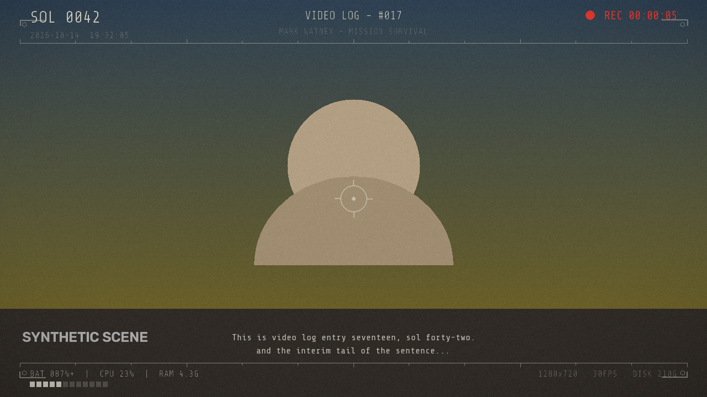
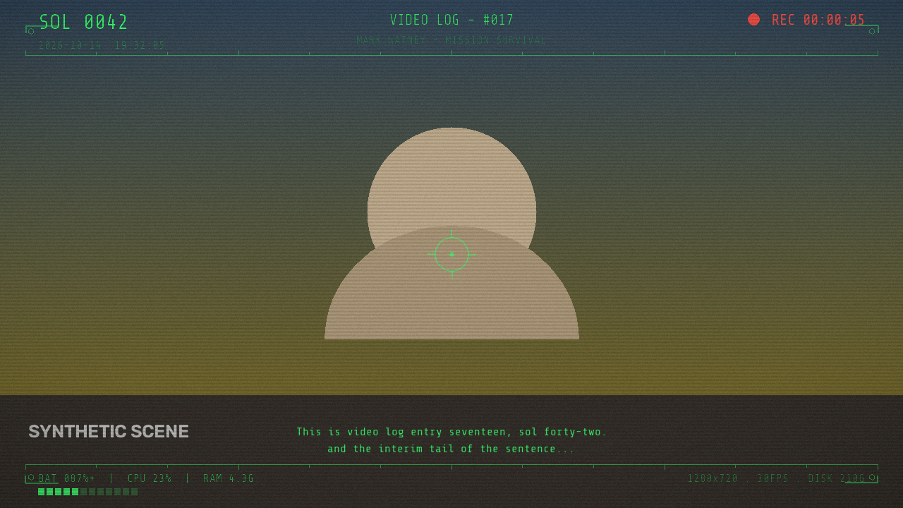

# The Martian Video Log

A Windows desktop app for recording **movie-style mission video logs**: it burns a
retro sci-fi HUD (REC timecode, SOL counter, telemetry, corner brackets, live
transcript ticker) plus CRT scanlines **directly into the saved MP4** — the
preview is exactly what you get. Every log entry is tracked in SQLite and
automatically transcribed and summarized with the Gemini Live API.

---


---

<br>

| Recording (mission_white) | Recording (green_phosphor) |
|---|---|
|  |  |

## Features

- **Burned-in HUD** — REC dot + mission timecode, `SOL NNNN` + Earth datetime,
  `VIDEO LOG - #NNN` with auto-incrementing entry number, live laptop telemetry
  (battery / CPU / RAM / mic level bar), hex corner brackets + crosshair,
  custom callsign line.
- **CRT retro effects** — fixed or rolling scanlines, vignette, film grain,
  optional 1px chromatic fringe on HUD text, boot-sequence flash at REC start.
- **Live AI transcription** — your speech is streamed to a Gemini Live model
  while recording; finals appear in the HUD ticker and are saved with the entry.
- **Automatic summary** — after each recording, a Gemini model returns a JSON
  summary (title / summary / topics / mood / highlights) that is written into
  the sidecar `.txt`.
- **Pause / resume mid-take** — mission time freezes; A/V sync is preserved
  because frames + audio are written only during active time.
- **HUD strength control** — opacity multiplier (0.4–2.0) plus an optional dark
  backing plate behind the HUD bands for bright scenes.
- **Clean shutdown** — toolbar `⏻ SHUTDOWN` button / `Ctrl+Q` with a
  confirmation dialog; refuses politely while a recording is active.
- **Library** — table of all entries with playback, sidecar inspection,
  one-click retry of failed AI jobs, and ZIP export (media + text + `index.csv`).
- **Crash-safe** — unfinished entries persist as `processing` and are resumed
  automatically on the next launch; leftover temp files are swept at startup.

## Requirements

- Windows 10/11 (camera opened via MSMF, falling back to DSHOW)
- [uv](https://docs.astral.sh/uv/getting-started/installation/) (installs Python
  for you if needed)
- A webcam and a microphone
- A Gemini API key (from <https://aistudio.google.com/apikey>)

## Setup

```bat
cd TheMartianVideoLog
uv sync
```

That single command fetches Python 3.12 if missing, creates `.venv` and
installs the exact dependency versions pinned in `uv.lock` — on a new machine,
`uv sync --frozen` reproduces this project byte-for-byte.

Put your key in `.env` next to `config.json` (or enter it later via
**Settings → API key**; Settings shows it masked and rewrites `.env`):

```
GEMINI_API_KEY=your_real_key_here
```

Run:

```bat
uv run python -m app.main
```

(`uv run` auto-syncs the environment before executing, so there is no
activate/deactivate dance.)

On first launch a wizard asks for your **callsign** and **landing date** (the
SOL counter is derived from it: `SOL = (today - landing).days`).

## Recording

1. The **Record** screen shows the live camera with the final HUD already
   burned in — pre-flight checks (camera, mic, ffmpeg, API key, disk) turn
   green in the status line.
2. **REC** starts recording; the HUD title switches from `STANDBY` to the next
   `VIDEO LOG - #NNN` and a boot-sequence flash plays.
3. **PAUSE** freezes mission time (blinking `PAUSED` overlay, `STBY` label);
   resume continues the same take.
4. **STOP** finalizes: the live session is closed, audio (WAV) and video (temp
   MP4) are muxed into the final H.264/AAC MP4, the entry is inserted into the
   database and the AI job (transcribe-from-file + summary + sidecars) runs in
   the background.

Takes shorter than ~1 s are discarded instead of saved (accidental clicks).

## Output files

Saved to `logs/`, named `VLOG_SOL{sol:04d}_{start datetime}.mp4`, e.g.:

```
VLOG_SOL042_20261014-1932.mp4
VLOG_SOL042_20261014-1932.txt
VLOG_SOL042_20261014-1932.srt
```

- **`.txt`** — metadata header (SOL, log number, model, timing, stats) +
  `SUMMARY` block + full `TRANSCRIPT`.
- **`.srt`** — timed captions, one cue per finalized transcription segment.
- Same-minute filename collisions get `_2`, `_3`, ... appended.

`logs/` may contain `app.log` (rotating application log).

## Gemini models

Recording streams mic audio to one **Live** model (selected in Settings):

| Model | Kind | Notes |
|---|---|---|
| `gemini-3.8-live` *(default)* | dialog | recommended all-rounder (AUDIO modality) |
| `gemini-3.1-flash-live-preview` | dialog | faster, lighter |
| `gemini-3.8-live-extended-thinking` | dialog | slower, more reasoning *(experimental)* |
| `gemini-3.5-transcribe-live` | pure ASR | `transcript_mode` = `SMART` / `VERBATIM` |
| `gemini-3.5-live-translate-preview` | translate | speech → `translate_target` language |
| `gemini-2.5-flash-native-audio-latest` | dialog | legacy fallback |

Dialog models **reject `TEXT` output modality outright** (verified Oct 2026),
so sessions connect directly with `AUDIO` modality + input transcription and a
"stay silent" system instruction — they only return your transcription. The
translate model streams `TEXT`. Live sessions have a 10-minute cap
(transcription) / 15-minute cap (audio), so long takes **roll over** at
9.0 / 13.5 min into a fresh session and the transcript continues seamlessly.

The **summary** is deliberately *not* taken from the live session: after the
recording finishes, the full transcript is sent to a standard
`generate_content` call (JSON-schema constrained) with the fallback chain
`gemini-3.8-flash → gemini-3.5-flash → gemini-3.5-flash-lite →
gemini-flash-latest → gemini-flash-lite-latest`. Each model gets one retry with
backoff on transient service errors (503 "high demand", dropped connections);
models that turn out to be 404-dead for your account are blacklisted for the
session. One reliable code path for every model choice.

If a take has no live transcript (e.g. the API was down), the background job
**re-transcribes from the final MP4**: 16 kHz mono PCM is extracted with
ffmpeg and streamed through the selected Live model at ~2x realtime, with
timestamps rescaled to the media timeline. Failed jobs can be retried from the
Library.

## Configuration (`config.json`)

Created with defaults on first run; all keys are also editable in Settings.

| Key | Default | Meaning |
|---|---|---|
| `callsign` | `MARK WATNEY - MISSION SURVIVAL` | HUD center line |
| `landing_date` | *(wizard)* | ISO date; SOL counter base |
| `live_model` | `gemini-3.8-live` | Live model used during recording + re-transcription |
| `summary_model` | `gemini-3.8-flash` | first choice of the summary chain |
| `transcript_mode` | `SMART` | `SMART` or `VERBATIM` (transcribe-live only) |
| `translate_target` | `en-US` | target language for the translate model |
| `custom_vocabulary` | Mars terms | boosts recognition of thematic words |
| `palette` | `mission_white` | `mission_white` / `green_phosphor` / `ares_blue` |
| `font` | `ShareTechMono` | `ShareTechMono` / `Michroma` / `Orbitron` |
| `hud.*` | all `true` | toggle any HUD element (`sol_date`, `title`, `rec`, `stats`, `res_info`, `brackets`, `live_transcript`) |
| `hud.opacity` | `1.0` | HUD strength: alpha multiplier for all HUD ink, 0.4–2.0 (raise it if the HUD looks too light on bright scenes) |
| `hud.backing` | `false` | dark plate behind the top/bottom HUD bands for maximum contrast |
| `effects.scanline_style` | `fixed` | `fixed` / `rolling` / `off` |
| `effects.scanline_opacity` | `0.12` | 0.0–0.5 |
| `effects.vignette` | `0.15` | 0.0–0.5 |
| `effects.noise` | `0.02` | 0.0–0.10 film grain |
| `effects.chromatic` | `false` | 1px R/B fringe on HUD text (costs a little perf) |
| `effects.boot_sequence` | `true` | boot flash at REC start |
| `resolution` | `[1280, 720]` | capture size (HUD scales with height) |
| `fps` | `30` | target frame rate |
| `camera_index` | `0` | webcam index |
| `audio_device` | *(default)* | empty = system default input |
| `audio_rate` | `48000` | mic sample rate |
| `save_dir` | `logs` | where finished MP4s live |

Video is encoded **H.264 (libx264 veryfast, crf 20) + AAC 128k, `-shortest`,
`+faststart`** via the bundled ffmpeg binary from `imageio-ffmpeg`.

## Architecture notes

```
main.py ─ MainWindow (⏻ SHUTDOWN button / Ctrl+Q with confirm dialog)
           ├─ RecordView  ◄── HudContext (shared state, GIL-atomic writes)
           │    ├─ VideoWorker (QThread)  camera → fit → HUD compose → mp4v temp
           │    ├─ AudioWorker (QThread)  mic → 48 kHz WAV + RMS + live feed
           │    ├─ LiveBridge/LiveTranscriber (raw-WS asyncio thread, rollover)
           │    └─ _MuxThread  ffmpeg mux → DB row → JobRunner queue
           ├─ LibraryView (playback / retry / export ZIP)
           └─ SettingsDialog (model, palette, font, HUD strength, effects, key)
```

- **A/V sync**: the video timeline is `frames_written / fps` and the audio
  timeline is `samples / rate`; both workers write only during active
  (unpaused) time, and the mux uses `-shortest`.
- **HUD performance** (~15 ms/frame worst case at 720p, 33 ms budget): chrome
  *and* every text that changes at most once per second are pre-composited into
  one **slow layer** (rebuilt when a content signature changes) and pasted as
  three band crops; per frame only the REC dot, timecode, mic bar (numpy slice
  blends) and transcript ticker are drawn, using an LRU cache of pre-rendered
  text strips. Scanlines/vignette are a single uint8 `cv2.multiply`, grain
  comes from a pre-generated add/subtract pool.
- **Live transcription speaks the raw WebSocket protocol** (see "Deliberate
  deviations"): the documented BidiGenerateContent frames over `websockets`,
  with proactive rollover, go-away handling and automatic reconnects.
- **Logging**: `logs/app.log` (rotating, 1 MB × 3, INFO) records job stages,
  session connects/errors and worker faults; `job` errors are stage-tagged in
  the DB (`transcribe: …`, `summary: …`, `sidecar: …`).
- **Threading**: workers are QThreads; the AI job runner is a daemon thread
  with a 3 s grace period on shutdown — unfinished rows persist as
  `processing` and are resumed on the next launch. SQLite access is guarded by
  a lock (`check_same_thread=False`).
- **Recording target**: 1280×720 @ 30 fps. The status line shows the effective
  capture rate while recording — if a machine cannot sustain ~30 fps the HUD
  effects (especially `rolling` scanlines + `chromatic`) can be relaxed.

### Deliberate deviations (documented design decisions)

- **Live streaming does not use `google-genai`'s live module.** The installed
  SDK (2.30.1) closes sessions right after setup when the server emits
  protocol frames it predates (`voiceActivity`, `sessionResumptionUpdate` —
  verified against the documented protocol in Oct 2026). The transcriber is a
  thin `websockets` client speaking `BidiGenerateContent` directly; the SDK is
  still used for `models.list` and the standard summary call.
- Summaries use a standard `generate_content` call on the final transcript
  instead of in-session summary output — one code path for all models.
- The summary-chain model list is account-aware: `gemini-2.5-flash` and
  `gemini-2.5-flash-lite` are 404 for new accounts and are learned/blacklisted
  at runtime instead of being hard-coded out.

## Tests

```bat
uv run python tests\smoke_test.py                 :: 14 unit/roundtrip checks
set QT_QPA_PLATFORM=offscreen && uv run python tests\ui_smoke.py
uv run python tests\hud_preview.py                :: renders tests/out/*.png + perf
set QT_QPA_PLATFORM=offscreen && uv run python tests\record_flow_test.py
set QT_QPA_PLATFORM=offscreen && uv run python tests\throughput_probe.py
```

`record_flow_test.py` performs a real 2.5 s recording (camera + mic) against a
sandboxed database and asserts pause/resume duration sync, mux output, DB row
integrity, temp-file cleanup and the AI-job error path. The smoke test
temporarily writes a placeholder API key but **restores your real key**
afterwards.

`tests/live_probe*.py` are diagnostics that talk to the real API (models.list,
raw protocol dumps, chain pings) — run them only when debugging the Gemini
pipeline; they use the key from `.env`.

## Troubleshooting

| Symptom | Fix |
|---|---|
| `NO SIGNAL` / camera red | Try another `camera_index` in Settings; MSMF is tried first, DSHOW as fallback. |
| Mic meter flat | Pick the input device in Settings (`audio_device`), check Windows privacy settings ("Let apps access your microphone"). |
| `ffmpeg not found` | The bundled binary from `imageio-ffmpeg` is used; if you moved the project, run `uv sync` again. |
| API pre-flight red | Set a real key in `.env` (the smoke test preserves whatever key is already there). |
| AI job error on an entry | Usually offline/API key/service overload; press **Retry AI** in the Library. The stage-tagged error is in the entry row and `logs/app.log`. |
| Capture rate < 30 fps | Close heavy apps; switch `scanline_style` to `fixed`, disable `chromatic`, or use 1280×720. |
| Window looks unstyled | Fonts load from `assets/fonts/`; don't delete that folder. |

## License

[MIT](LICENSE) © 2026 Fabio Matricardi. The bundled fonts
(ShareTechMono, Michroma, Orbitron) are distributed under the
SIL Open Font License 1.1.
| Live session drops at ~10 min | Expected; the app rolls over at 9 min automatically. |

## Project layout

```
app/
  main.py               entry point, first-run wizard
  core/                 config, SOL math, filenames, stats, export
  db/                   sqlite repository (entries)
  capture/              video/mic workers, ffmpeg muxer
  hud/                  overlay compositor, effects, fonts
  ai/                   model registry, live session, summarizer, sidecars, jobs
  ui/                   record/library/settings/theme/main window
assets/fonts/           ShareTechMono, Michroma, Orbitron (OFL)
tests/                  smoke / ui / hud preview / record flow / perf probes
```
